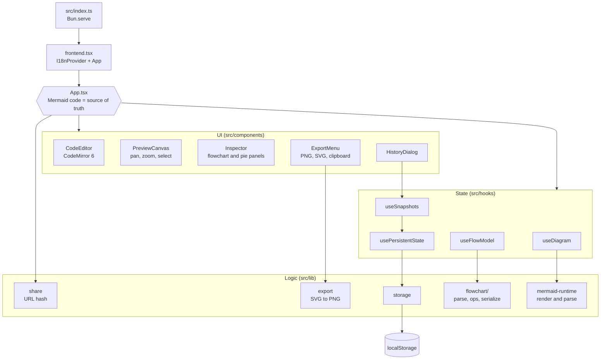

# Mermaid Drawing

A free, local-first Mermaid editor. Everything runs in the browser and is kept in `localStorage`; there is no backend.

- **Code editor** (CodeMirror 6) with Mermaid syntax highlighting and error markers
- **Live preview** (Mermaid.js) with pan, zoom (Ctrl/Cmd + wheel) and fit-to-screen
- **Visual editor** – click elements in the preview to edit them (see below)
- **Export** PNG (1x–4x, transparent background option), SVG, or copy the image to the clipboard
- **Share** link – the whole diagram is packed into the URL hash
- Version **history**, undo/redo, light/dark theme, diagram themes, 12 starter templates
- **Languages**: English, Lithuanian, Spanish, French, German, Russian

## Visual editor

| Diagram | What you can do |
| --- | --- |
| Flowchart | Click a node, arrow or group to select it. Double-click to rename inline. Change shape, fill / border / text colour, border width, arrow label, line style (solid / dotted / thick), arrow ends, direction. Add nodes, add connected nodes, connect two nodes, duplicate, reverse, delete (Delete key), ungroup. |
| Pie chart | Edit title, "show values", and slices (label, value, add, remove). |

Visual edits are applied to the code, which stays the single source of truth (they are undoable like typing).
Flowcharts are parsed with Mermaid's own parser and written back as canonical code, so **comments inside the diagram are not kept** when you edit visually. Front matter and `%%{init}%%` directives are kept.

## Develop

```bash
bun install
bun dev          # http://localhost:3000, hot reload
bun check        # type check
bun test         # unit tests
bun run build    # production build into dist/
bun e2e          # browser tests (needs the dev server running and Google Chrome)
```

Set `CHROME_PATH` if Chrome is not at `/Applications/Google Chrome.app/Contents/MacOS/Google Chrome`.

## Translations

Strings live in `src/locales/translations.json` as `{ "key": { "en": "…", "lt": "…" } }`, read through
`src/lib/translate.ts` (typed keys, plurals, `{param}` templates). In components use `const t = useTranslate()`.
To add a language, add its code to every key in the JSON – the language list is derived from it.

## Layout

```
src/lib/flowchart/   model, parser (Mermaid's db), serializer, pure editing operations
src/lib/pie.ts       pie model
src/lib/export.ts    SVG → PNG / SVG / clipboard
src/components/      UI (shadcn/ui in components/ui), preview canvas, inspector panels
e2e/run.mjs          Playwright (playwright-core) browser tests
```

## Architecture

The Mermaid code in the editor is the single source of truth. `App` keeps the text and sends it to the renderer.
A click in the preview becomes a selection. An inspector edit changes the parsed model, and the serializer writes new code back into the editor.



Exported image of the same chart. It has a transparent background. GitHub shows the light or the dark version to match your theme.
Files: `docs/architecture.svg` and `docs/architecture-dark.svg` (PNG copies: [light](docs/architecture.png), [dark](docs/architecture-dark.png)).

<picture>
  <source media="(prefers-color-scheme: dark)" srcset="docs/architecture-dark.svg">
  
</picture>

To rebuild the images after you change the chart, run `bun run docs:chart` (needs Google Chrome, like `bun e2e`).
